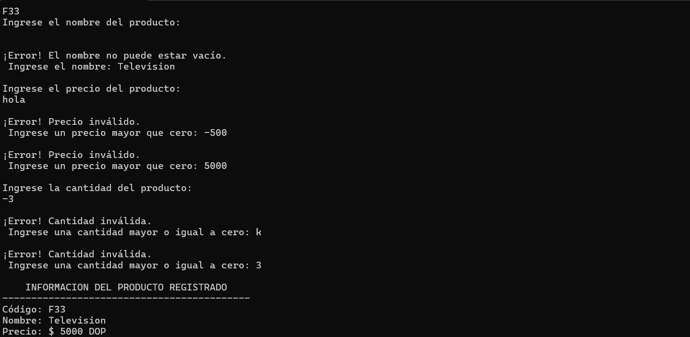
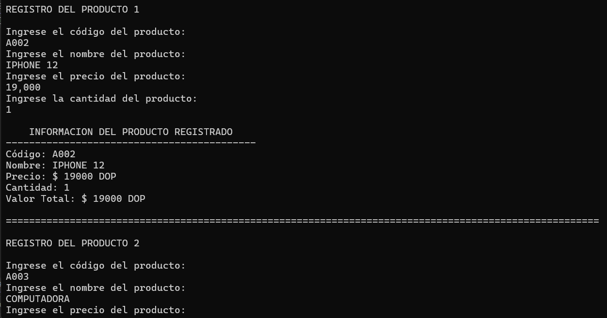
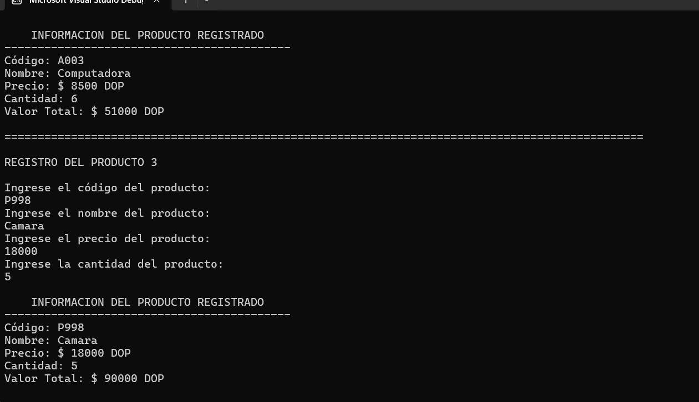
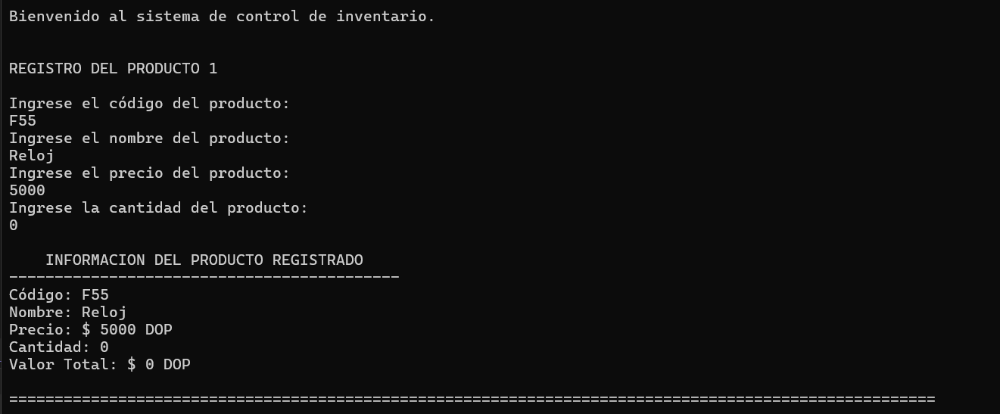

# Control de Inventario TecnoPunto

## Información del autor
- Nombre: Astrid Carolina De La Cruz De La Cruz
- Matrícula: 2026-1718
- Asignatura: Programación Básica

## Descripción del proyecto
Este proyecto consiste en una aplicación de consola desarrollada en C# para registrar y mostrar información de productos de la tienda TecnoPunto.

## Datos de entrada
El programa solicita los siguientes datos:
- Código del producto.
- Nombre del producto.
- Precio.
- Cantidad disponible.

## Procesamiento
El sistema utiliza una clase llamada `Producto`, con propiedades, validaciones, un constructor y un método para mostrar la información.

También calcula el valor total de cada producto multiplicando su precio por la cantidad disponible.

## Datos de salida
El programa muestra:
- Código.
- Nombre.
- Precio.
- Cantidad.
- Valor total del producto.

## Validaciones
- El nombre no puede estar vacío.
- El precio debe ser mayor que cero.
- La cantidad no puede ser negativa.
- Se comprueba que los datos numéricos tengan un formato válido.

## Capturas de pantalla

### Datos inválidos

### Validación del producto 1

### Validación del producto 2

### Cantidad Cero
